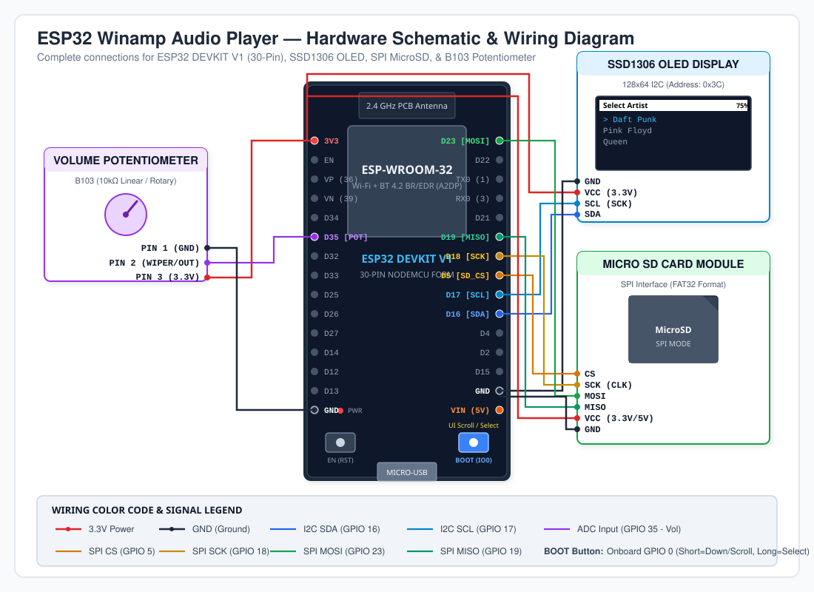

# Hardware Schematics and Wiring Guide

This document provides complete schematics, connection tables, board pinout mappings, and architectural diagrams for the **ESP32 Winamp MP3 Player**.

---

## 1. Visual Schematic Diagram

An interactive vector graphic of the complete system wiring is available in [`docs/schematics.svg`](docs/schematics.svg).



---

## 2. Block Diagram

```
                              +------------------------+
                              |   5V USB Power Supply  |
                              +-----------+------------+
                                          | (Micro-USB / VIN)
                                          v
+-----------------------+     +------------------------+     +--------------------------+
|  SSD1306 OLED Display |     |      ESP32 DEVKIT      |     |  MicroSD SPI Card Reader |
|      (128x64 I2C)     |     |   (ESP-WROOM-32, 30P)  |     |      (FAT32 Audio)       |
|                       |     |                        |     |                          |
|  VCC  <---------------+-----+ 3.3V                   |     |  VCC  <------------------+ 3.3V / VIN (5V)*
|  GND  <---------------+-----+ GND                    |     |  GND  <------------------+ GND
|  SDA  <---------------+-----+ GPIO 16                |     |  CS   <------------------+ GPIO 5
|  SCL  <---------------+-----+ GPIO 17                |     |  SCK  <------------------+ GPIO 18
+-----------------------+     |                        |     |  MOSI <------------------+ GPIO 23
                              |                        |     |  MISO <------------------+ GPIO 19
+-----------------------+     |                        |     +--------------------------+
|   B103 Potentiometer  |     |                        |
|  (10k Linear / Rotary)|     |                        |     +--------------------------+
|                       |     |                        |     |   Bluetooth Audio Sink   |
|  Pin 1 (GND) <--------+-----+ GND                    |     |  (Speaker / Headphones)  |
|  Pin 2 (Out) -------->+-----+ GPIO 35 (ADC1_CH7)     |     |                          |
|  Pin 3 (3.3V)<--------+-----+ 3.3V                   |     |  A2DP Source (Wireless)  |
+-----------------------+     |                        |~~~~>|  SBC / 44.1kHz Stereo   |
                              |  GPIO 0 (BOOT Button)  |     +--------------------------+
                              |  [Onboard: Scroll/Sel] |
                              +------------------------+
```
*\* Note on MicroSD VCC: Most standard MicroSD breakout modules feature an onboard 3.3V LDO regulator; they can be safely powered from 3.3V or 5V (VIN). For modules with a 3.3V-only regulator, 5V (VIN) is recommended.*

---

## 3. Mermaid Architecture & Connection Diagram

```mermaid
graph TD
    subgraph ESP32 ["ESP32 DEVKIT V1 (30-Pin)"]
        ESP_3V3["3.3V Rail"]
        ESP_5V["VIN (5V)"]
        ESP_GND["GND Rail"]
        ESP_IO16["GPIO 16 (RX2 / I2C SDA)"]
        ESP_IO17["GPIO 17 (TX2 / I2C SCL)"]
        ESP_IO5["GPIO 5 (VSPI CS)"]
        ESP_IO18["GPIO 18 (VSPI SCK)"]
        ESP_IO23["GPIO 23 (VSPI MOSI)"]
        ESP_IO19["GPIO 19 (VSPI MISO)"]
        ESP_IO35["GPIO 35 (ADC1 CH7 - Input Only)"]
        ESP_IO0["GPIO 0 (BOOT Button - Pulled Up)"]
        ESP_BT["A2DP Bluetooth Stack (Core 1)"]
    end

    subgraph OLED ["SSD1306 OLED (128x64 I2C, Addr: 0x3C)"]
        OLED_VCC["VCC"]
        OLED_GND["GND"]
        OLED_SDA["SDA"]
        OLED_SCL["SCL"]
    end

    subgraph SD ["MicroSD Card Reader (SPI Mode)"]
        SD_VCC["VCC (3.3V or 5V)"]
        SD_GND["GND"]
        SD_CS["CS"]
        SD_SCK["SCK"]
        SD_MOSI["MOSI"]
        SD_MISO["MISO"]
    end

    subgraph POT ["B103 Potentiometer (Volume Control)"]
        POT_GND["Pin 1 (GND)"]
        POT_WIPER["Pin 2 (Wiper Output)"]
        POT_VCC["Pin 3 (3.3V Reference)"]
    end

    subgraph BTSINK ["Bluetooth Receiver"]
        BT_DEV["BT Speaker / Headphones (A2DP Sink)"]
    end

    %% OLED Connections
    ESP_3V3 --> OLED_VCC
    ESP_GND --> OLED_GND
    ESP_IO16 --> OLED_SDA
    ESP_IO17 --> OLED_SCL

    %% SD Card Connections
    ESP_3V3 -.->|or 5V if module has 3.3V LDO| SD_VCC
    ESP_GND --> SD_GND
    ESP_IO5 --> SD_CS
    ESP_IO18 --> SD_SCK
    ESP_IO23 --> SD_MOSI
    ESP_IO19 --> SD_MISO

    %% Potentiometer Connections
    ESP_GND --> POT_GND
    POT_WIPER --> ESP_IO35
    ESP_3V3 --> POT_VCC

    %% Bluetooth
    ESP_BT -.->|A2DP 44.1kHz SBC Stream| BT_DEV
```



---

## 4. Complete Pinout Table

### 4.1 Master Interconnection Matrix

| Module / Component | Module Pin | ESP32 GPIO / Pin | ESP32 Function | Signal Type | Description |
| :--- | :--- | :--- | :--- | :--- | :--- |
| **SSD1306 OLED** | `VCC` | `3V3` | 3.3V Power Out | Power | Display power (3.3V, ~20mA) |
| | `GND` | `GND` | Ground | Ground | Common Ground |
| | `SCL` | `GPIO 17` | `OLED_SCL` | Digital I/O | I2C Clock line |
| | `SDA` | `GPIO 16` | `OLED_SDA` | Digital I/O | I2C Data line |
| **MicroSD Reader** | `VCC` | `3V3` / `VIN` | 3.3V or 5V Out | Power | SD Card power (Module dependent) |
| | `GND` | `GND` | Ground | Ground | Common Ground |
| | `CS` | `GPIO 5` | `SD_CS` | Digital Output | SPI Chip Select |
| | `SCK` | `GPIO 18` | `SD_SCK` | Digital Output | SPI Clock |
| | `MOSI` | `GPIO 23` | `SD_MOSI` | Digital Output | SPI Master Out Slave In |
| | `MISO` | `GPIO 19` | `SD_MISO` | Digital Input | SPI Master In Slave Out |
| **B103 Potentiometer** | `Pin 1` | `GND` | Ground | Ground | Analog low reference (0V) |
| | `Pin 2 (Wiper)` | `GPIO 35` | `POT_PIN` | Analog Input | Voltage divider output (0 - 3.3V) |
| | `Pin 3` | `3V3` | 3.3V Power Out | Power | Analog high reference (3.3V) |
| **BOOT Button** | `Button Pin` | `GPIO 0` | `BTN_SCROLL` | Digital Input | Onboard button (Internal pull-up) |

---

## 5. ESP32 DEVKIT V1 (30-Pin) Physical Board Layout

The pinout corresponds to the standard 30-pin ESP32 DEVKIT V1 board (ESP-WROOM-32):

```
                       +-------------------+
                       |    [PCB ANT]      |
                       |  ESP-WROOM-32     |
                       |                   |
            3V3  [ 1]  |                   |  [30]  VIN (5V)
             EN  [ 2]  |                   |  [29]  GND
       (36)  VP  [ 3]  |                   |  [28]  GPIO 13
       (39)  VN  [ 4]  |                   |  [27]  GPIO 12
            D34  [ 5]  |                   |  [26]  GPIO 14
 [POT]      D35  [ 6]  |                   |  [25]  GPIO 27
            D32  [ 7]  |                   |  [24]  GPIO 26
            D33  [ 8]  |                   |  [23]  GPIO 25
            D25  [ 9]  |                   |  [22]  GPIO 33
            D26  [10]  |                   |  [21]  GPIO 32
            D27  [11]  |                   |  [20]  GPIO 35 (or D21 depending on pinout variant)
            D14  [12]  |                   |  [19]  GPIO 19 [SD_MISO]
            D12  [13]  |                   |  [18]  GPIO 18 [SD_SCK]
            D13  [14]  |                   |  [17]  GPIO 5  [SD_CS]
            GND  [15]  |                   |  [16]  GPIO 17 [OLED_SCL]
                       |   [EN]     [BOOT] |  [--]  GPIO 16 [OLED_SDA]
                       |  (RST)     (IO0)  |  [--]  GPIO 23 [SD_MOSI]
                       |      [MicroUSB]   |
                       +-------------------+
```

---

## 6. Important Hardware & Design Notes

### 6.1 Analog Volume Input (GPIO 35 & ADC1)
- **ADC1 Pin Selection:** GPIO 35 belongs to **ADC1** (`ADC1_CH7`). In the ESP32, **ADC2** pins (GPIOs 0, 2, 4, 12-15, 25-27) cannot be used while the Wi-Fi or Bluetooth controller is active. Using GPIO 35 guarantees that reading the volume potentiometer does not conflict with the Bluetooth A2DP audio stream.
- **Input-Only GPIO:** GPIO 35 is an input-only pin on the ESP32. It does not have internal pull-up or pull-down resistors, making it ideal for pure analog potentiometer inputs.
- **Dead Zone Filtering:** The software in `src/main.cpp` applies dead-zone hysteresis (`abs(new_volume - current_volume) > 1`) to eliminate analog noise and prevent spurious volume redraws.

### 6.2 I2C Display Interface (GPIO 16 & GPIO 17)
- **Software Assignment:** The SSD1306 OLED display uses `Wire.begin(OLED_SDA, OLED_SCL)`, where `OLED_SDA` is GPIO 16 and `OLED_SCL` is GPIO 17.
- **I2C Address:** 7-bit slave address `0x3C`.
- **Pull-up Resistors:** Most standard 0.96" SSD1306 breakout boards include onboard 4.7kΩ or 10kΩ I2C pull-up resistors to 3.3V.

### 6.3 SPI MicroSD Card Interface
- **Bus Speed & Stability:** SD card communication uses standard hardware SPI lines (MOSI=23, MISO=19, SCK=18, CS=5). Keep the wiring between the ESP32 and SD card reader short (< 10 cm) to avoid signal integrity issues when reading MP3 audio chunks.
- **Card Format:** The SD card must be formatted as **FAT32** with an `Artist/Album/song.mp3` hierarchy.

### 6.4 Power Supply Considerations
- When streaming Bluetooth A2DP audio and reading from the SD card simultaneously, current consumption can peak up to **250–350 mA**.
- Ensure the ESP32 is powered with a quality USB cable and a 5V power source capable of delivering at least **1.0 A**.
